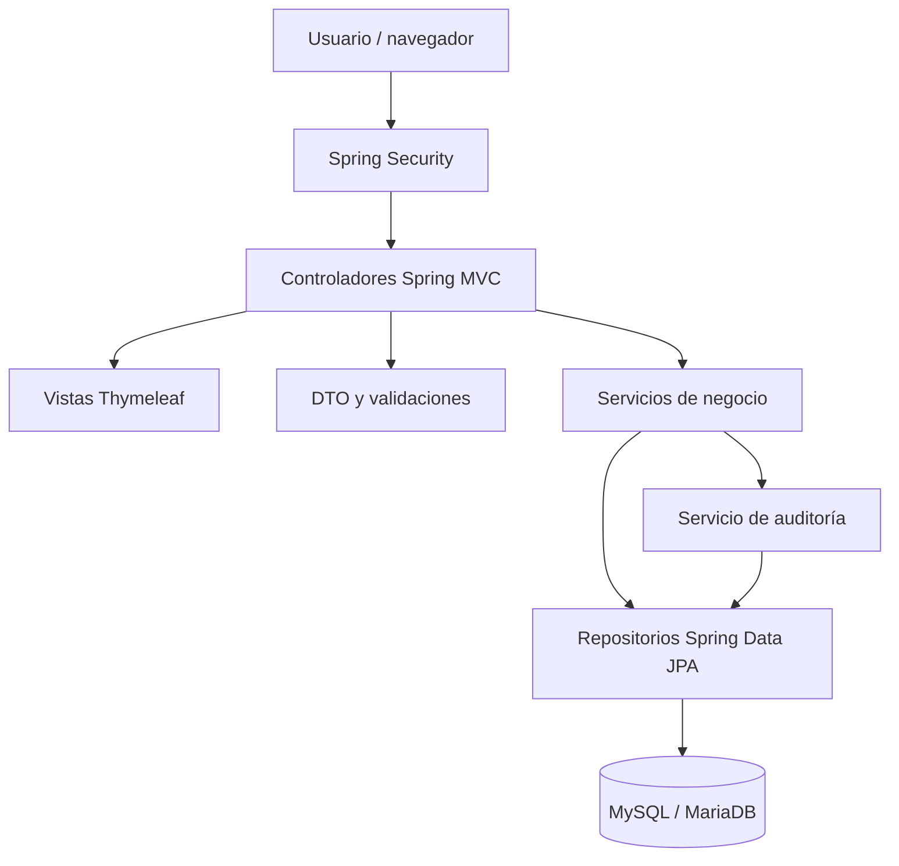
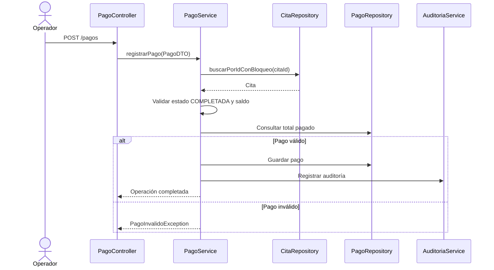
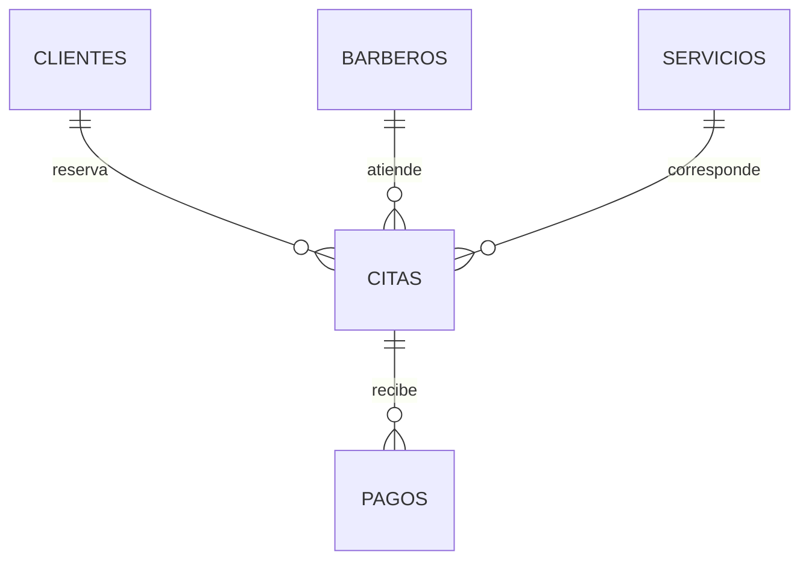
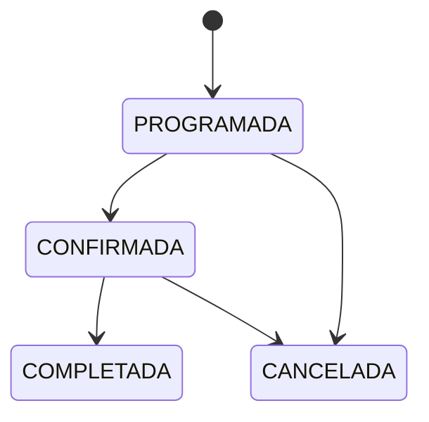

# 💈 Barber Admin

**Sistema web de gestión para barberías**, desarrollado con **Java 25, Spring Boot 4.1.1 y Thymeleaf**. Permite administrar clientes, barberos, servicios, citas, cobros, usuarios, reportes y registros de auditoría desde una aplicación web con autenticación.

> **Estado:** proyecto en desarrollo. Este README describe el código disponible en la rama `main`; no implica que exista un despliegue público ni que se hayan ejecutado pruebas automatizadas durante su elaboración.

## 📑 Contenido

- [Tecnologías](#-tecnologías)
- [Características y módulos](#-características-y-módulos)
- [Arquitectura](#-arquitectura)
- [Modelo de datos](#-modelo-de-datos)
- [Reglas de negocio](#-reglas-de-negocio)
- [Seguridad](#-seguridad)
- [Instalación local](#-instalación-local)
- [Estructura del proyecto](#-estructura-del-proyecto)
- [Documentación técnica](#-documentación-técnica)
- [Observaciones técnicas](#-observaciones-técnicas)

## 🧰 Tecnologías

| Tecnología | Uso |
|---|---|
| Java 25 | Lenguaje de programación |
| Spring Boot 4.1.1 | Framework y configuración de la aplicación |
| Spring MVC | Controladores y rutas HTTP |
| Thymeleaf | Plantillas HTML renderizadas en servidor |
| Spring Data JPA / Hibernate | Persistencia de entidades y repositorios |
| MySQL Connector/J | Conexión JDBC |
| MariaDB / MySQL | Base de datos relacional; el proyecto configura `MariaDBDialect` |
| Spring Security | Autenticación y autorización |
| BCrypt | Hash de contraseñas |
| Jakarta Validation | Validación de DTO y formularios |
| Lombok | Generación de métodos de acceso |
| Apache POI 5.4.1 | Exportación de archivos Excel (.xlsx) |
| Maven Wrapper | Compilación y ejecución sin instalación global de Maven |

Versiones y dependencias verificadas en [`pom.xml`](pom.xml). Configuración de base de datos en [`application.properties`](src/main/resources/application.properties).

## ✨ Características y módulos

| Módulo | Funcionalidad principal | Ruta base |
|---|---|---|
| Inicio / dashboard | Indicadores de clientes, barberos activos, servicios activos y citas del día | `/` |
| Clientes | Listar, registrar, editar y eliminar clientes | `/clientes` |
| Barberos | Registrar, editar, activar y desactivar personal | `/barberos` |
| Servicios | Catálogo de servicios, precio, duración y activación/desactivación | `/servicios` |
| Citas | Registrar, consultar, confirmar, completar, cancelar y ver agenda por fecha | `/citas` |
| Pagos | Registrar abonos, consultar historial, saldo y resumen por cita | `/pagos` |
| Reportes | Ingresos diarios, mensuales y por método de pago y rango de fechas | `/reportes` |
| Usuarios | Crear cuentas, activar/desactivar y restablecer contraseñas | `/usuarios` |
| Mi cuenta | Cambiar la propia contraseña | `/mi-cuenta` |
| Auditoría | Consultar actividad con filtros, paginación y exportación XLSX | `/auditoria` |
| Dashboard de auditoría | Estadísticas de actividades y acciones | `/auditoria/dashboard` |

Las rutas anteriores se han contrastado con los controladores Java. Los accesos concretos dependen de la configuración de seguridad.

## 🏗️ Arquitectura

La aplicación sigue una arquitectura en capas: **presentación → lógica de negocio → persistencia → base de datos**. Los controladores Spring MVC renderizan plantillas Thymeleaf; los servicios encapsulan validaciones y transacciones; los repositorios JPA acceden a los datos.



### Flujo de registro de pagos



> El diagrama representa el flujo del servicio. El controlador muestra el resultado exitoso o regresa al formulario cuando se produce un error de negocio.

## 🗃️ Modelo de datos

Entidades JPA identificadas: **Cliente, Barbero, Servicio, Cita, Pago, Usuario y Auditoria**.



- Cada cita referencia un cliente, un barbero y un servicio.
- Una cita puede registrar varios pagos parciales.
- Los usuarios y las auditorías no tienen una clave foránea JPA directa entre sí: `Auditoria.username` es un campo de texto.
- `EstadoCita`, `MetodoPago`, `Rol` y `EstadoPago` son enumeraciones Java, no tablas independientes.

Consulta el [diccionario de datos](docs/base-datos/diccionario-datos.md) y el [diagrama entidad-relación detallado](docs/diagramas/entidad-relacion.md).

## 📋 Reglas de negocio

**Citas** — `CitaService` verifica la existencia del cliente, barbero y servicio; exige barbero y servicio activos; impide citas en el pasado y citas que terminen otro día; comprueba solapamientos de horario para el mismo barbero. La transición de estados es:



**Pagos** — `PagoService.registrarPago` solo permite abonos de citas **COMPLETADAS**, exige monto positivo y no permite exceder el saldo pendiente. La operación es transaccional y bloquea la fila de la cita al registrar el pago. Medios: **EFECTIVO, YAPE, PLIN y TARJETA**. El resumen financiero clasifica las citas como **PENDIENTE, PARCIAL o PAGADO**, calculado a partir del importe total y los abonos.

**Usuarios** — `UsuarioService` valida nombres de usuario únicos, cifra contraseñas con BCrypt, evita desactivar la propia cuenta y protege al último administrador activo de ser desactivado.

**Auditoría** — registra eventos de negocio, permite filtrar por usuario, acción y fechas, y exportar registros en formato Excel.

## 🔐 Seguridad

La configuración de [`SecurityConfig.java`](src/main/java/com/practicando/practicando/config/SecurityConfig.java) define:

- Autenticación mediante formulario en `/login`.
- Rutas públicas para login y recursos estáticos.
- Acceso exclusivo para el rol **ADMIN** a `/usuarios/**`, `/reportes/**` y `/auditoria/**`.
- Resto de rutas disponibles para usuarios autenticados.
- Contraseñas almacenadas como hashes BCrypt.

Roles definidos: `ADMIN` y `BARBERO`. El sistema crea un usuario inicial `admin` **solo si no hay usuarios en la base de datos** y se ha configurado una contraseña inicial de al menos 12 caracteres.

## 🚀 Instalación local

### 1. Requisitos

- **JDK 25** instalado y disponible en `PATH`.
- **MySQL o MariaDB** en ejecución (por ejemplo, con XAMPP).
- **Git** para clonar el repositorio.
- Acceso autorizado al repositorio privado.

No es necesario instalar Maven globalmente porque se incluye el wrapper.

### 2. Clonar el proyecto

```powershell
git clone https://github.com/Thony1724/barber-admin.git
cd barber-admin
```

GitHub solicitará autenticación si aún no tienes acceso configurado.

### 3. Crear la base de datos

En MySQL/MariaDB:

```sql
CREATE DATABASE IF NOT EXISTS barberia_db
  CHARACTER SET utf8mb4
  COLLATE utf8mb4_unicode_ci;
```

El archivo [`src/main/resources/application.properties`](src/main/resources/application.properties) contiene la configuración de desarrollo:

```properties
spring.datasource.url=jdbc:mysql://localhost:3306/barberia_db
spring.datasource.username=root
spring.datasource.password=
spring.jpa.hibernate.ddl-auto=update
spring.jpa.database-platform=org.hibernate.dialect.MariaDBDialect
```

Ajusta usuario, contraseña y puerto según tu instalación. La contraseña vacía corresponde a la configuración actual de desarrollo; **no se recomienda para producción**. `ddl-auto=update` tampoco debe asumirse como estrategia de migración para producción.

### 4. Configurar la contraseña inicial del administrador

Antes del primer arranque, si la tabla `usuarios` está vacía, define una contraseña de al menos **12 caracteres** mediante la variable de entorno `APP_ADMIN_INITIAL_PASSWORD`.

En **PowerShell** (sesión actual):

```powershell
$env:APP_ADMIN_INITIAL_PASSWORD = "REEMPLAZAR_CON_UNA_CLAVE_SEGURA"
```

No publiques contraseñas reales ni las incluyas en commits. La configuración se lee desde `app.admin.initial-password` en [`UsuarioInicialConfig.java`](src/main/java/com/practicando/practicando/config/UsuarioInicialConfig.java).

### 5. Ejecutar la aplicación

En **Windows / PowerShell**, desde la raíz del proyecto:

```powershell
.\mvnw.cmd spring-boot:run
```

En **Linux/macOS**:

```bash
./mvnw spring-boot:run
```

Con la configuración web predeterminada de Spring Boot, abre **http://localhost:8080/login**. Si cambiaste el puerto del servidor, utiliza el correspondiente.

### 6. Iniciar sesión

- Usuario inicial: `admin`.
- Contraseña: la definida en `APP_ADMIN_INITIAL_PASSWORD`.

La creación automática solo se realiza cuando no existen usuarios. Para arranques posteriores se utilizan las cuentas persistidas.

### 7. Compilar y ejecutar pruebas

```powershell
.\mvnw.cmd clean verify
```

Este comando compila y ejecuta las verificaciones configuradas; **no se afirma aquí que las pruebas hayan pasado**.

## 📂 Estructura del proyecto

```text
barber-admin/
├── .mvn/                         # Configuración del Maven Wrapper
├── docs/
│   ├── base-datos/
│   │   └── diccionario-datos.md
│   └── diagramas/
│       └── entidad-relacion.md
├── src/
│   ├── main/
│   │   ├── java/com/practicando/practicando/
│   │   │   ├── config/          # Seguridad e inicialización
│   │   │   ├── controller/      # Controladores MVC
│   │   │   ├── dto/             # Objetos de transferencia y validación
│   │   │   ├── exception/       # Excepciones de negocio
│   │   │   ├── model/           # Entidades y enumeraciones
│   │   │   ├── repository/      # Acceso a datos
│   │   │   ├── service/         # Lógica de negocio
│   │   │   └── PracticandoApplication.java
│   │   └── resources/
│   │       ├── static/          # Recursos CSS, JS e imágenes
│   │       ├── templates/       # Plantillas Thymeleaf
│   │       └── application.properties
│   └── test/
├── mvnw
├── mvnw.cmd
└── pom.xml
```

## 📚 Documentación técnica

| Documento | Contenido |
|---|---|
| [Diccionario de datos](docs/base-datos/diccionario-datos.md) | Entidades JPA, columnas, tipos, restricciones y relaciones |
| [Diagrama entidad-relación](docs/diagramas/entidad-relacion.md) | Modelo relacional documentado en Mermaid |

Esta documentación se basa en el código fuente; las restricciones físicas de la base de datos deben contrastarse con el esquema instalado.

## ⚠️ Observaciones técnicas

- **Corrección aplicada:** [`PagoController.guardar`](src/main/java/com/practicando/practicando/controller/PagoController.java) muestra el mensaje de éxito y redirige a `/pagos` únicamente después de registrar correctamente el pago. Si ocurre una `PagoInvalidoException`, muestra el error y vuelve al formulario `pagos-form`.
- El proyecto usa `spring.jpa.hibernate.ddl-auto=update` para desarrollo; para producción conviene planificar migraciones versionadas y una configuración segura de credenciales.
- El repositorio es privado: los enlaces a código y documentación requieren permisos de acceso.

---

**Barber Admin** · Documentación técnica en español basada en el código fuente de `Thony1724/barber-admin`.
