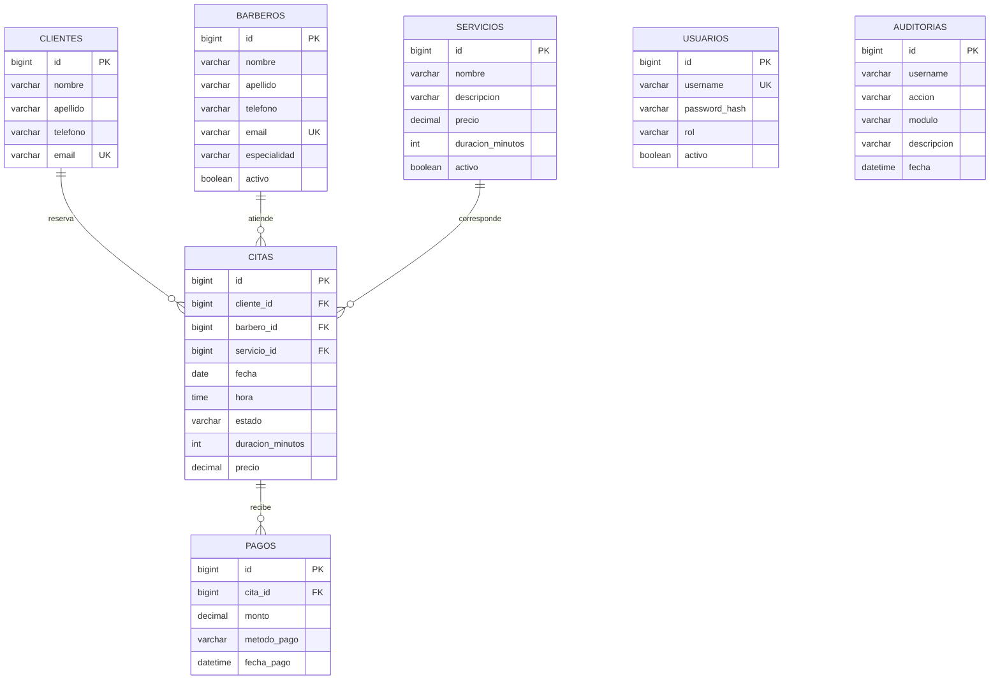

# Diagrama entidad-relación — Barber Admin

El siguiente diagrama Mermaid representa las **siete entidades JPA verificadas** en `src/main/java/com/practicando/practicando/model/` y sus cuatro relaciones `@ManyToOne`. Los tipos se muestran de forma conceptual, basados en las clases Java; no sustituyen la definición SQL de MariaDB.

## Lectura del modelo

- Un cliente, un barbero o un servicio puede aparecer en muchas citas; cada cita exige exactamente una referencia a cada uno.
- Una cita puede recibir cero o más pagos; cada pago pertenece a una cita.
- `USUARIOS` y `AUDITORIAS` aparecen sin conectores porque **no existe una relación JPA explícita** entre ellos. El campo `auditorias.username` guarda texto.
- `EstadoCita`, `MetodoPago`, `Rol` y `EstadoPago` son enumeraciones Java, no entidades; los valores persistidos de los tres primeros se almacenan como texto.
- Las cardinalidades se deducen de `@ManyToOne(optional=false)` y no expresan reglas adicionales de negocio.

## Archivos fuente

- `model/Cliente.java`
- `model/Barbero.java`
- `model/Servicio.java`
- `model/Cita.java`
- `model/Pago.java`
- `model/Usuario.java`
- `model/Auditoria.java`

Para atributos, longitudes, precisión decimal y restricciones, consultar [Diccionario de datos](../base-datos/diccionario-datos.md).

> **Nota:** este diagrama documenta el modelo JPA del repositorio, no una introspección de la base de datos instalada.
